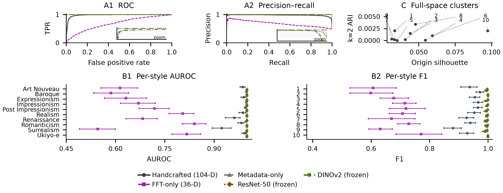
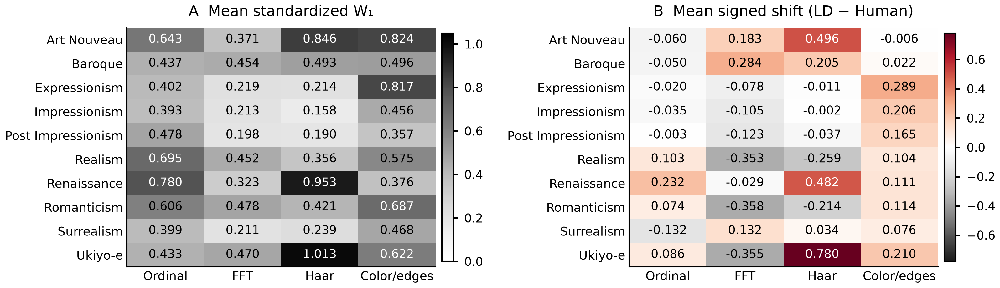
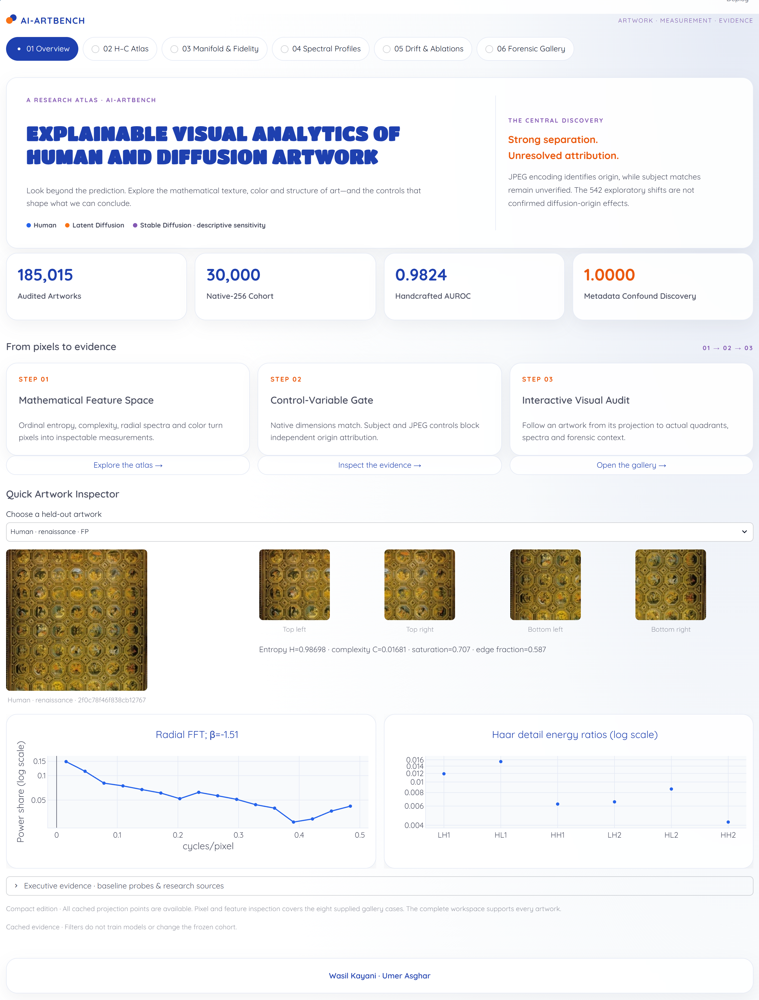
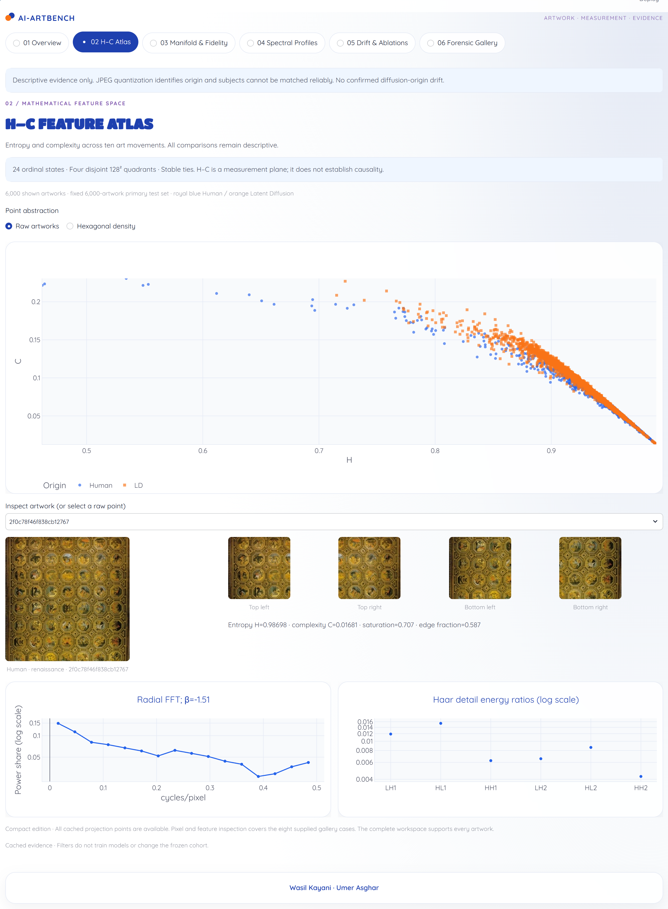

# Explainable diffusion-art analytics

This repository contains the paper, implementation and lightweight evidence for a control-gated comparison of Human and diffusion artwork in AI-ArtBench. The primary test uses 6,000 native-256 Human/Latent Diffusion artworks drawn from a frozen 30,000-artwork cohort. The full audit covers 185,015 files.

The handcrafted probe predicts release origin well, but frozen learned features predict more strongly. JPEG encoding identifies origin perfectly in the metadata diagnostic and verified subject matches are unavailable. The 542 exploratory statistical passes therefore yield zero eligible confirmatory origin effects. The atlas is descriptive; a high AUC does not establish independent attribution.

Official repository: https://github.com/wasil-7/explainable-diffusion-art-analytics

## Results

| Frozen probe | Test AUROC | Test F1 |
|---|---:|---:|
| Handcrafted, 104 predictors | 0.9824 | 0.9420 |
| FFT only | 0.6839 | 0.6830 |
| Metadata diagnostic | 1.0000 | 0.9997 |
| ResNet-50 | 0.9999 | 0.9972 |
| DINOv2 ViT-S/14 | 0.9997 | 0.9955 |

Source-group bootstrap intervals and paired differences are in `analysis/results/`. Five supplementary grouped repartitions give handcrafted AUROC 0.981684 ± 0.002027. They reuse the original selected cohort, fixed feature-extraction calibration and cached learned vectors; they are not independent collections or full pipeline repetitions.



The drift heatmap separates nonnegative standardized Wasserstein distance from signed LD-minus-Human median shift. All family cells contain exploratory constituents; redundant asterisks are omitted. These are descriptive summaries, not confirmed family-level effects.



## Dashboard

The Streamlit application links six views, movement/origin filters, fixed-axis projections and a forensic gallery. The compact package includes all plotted summary points and eight pixel-inspectable cases. Full arbitrary-artwork inspection needs the original local archive and feature caches.





## Environment and quick checks

The recorded environment uses Python 3.12.16, PyTorch 2.6.0+cu124, torchvision 0.21.0+cu124, NumPy 2.5.4, SciPy 1.18.1, scikit-learn 1.9.1, pandas 3.1.1, Streamlit 1.67.0 and Plotly 7.1.0. `requirements.txt` pins the captured distributions. The original GPU was a GTX 1650 SUPER with 4 GB VRAM; encoder inference used CUDA FP16 and 32-quadrant batches. The original cuDNN version was not recorded. Native-library availability can depend on host policy.

On the original Windows workstation:

```powershell
$env:PIP_CACHE_DIR='D:\Dev\pip_cache'
$env:TEMP='D:\Dev\tmp'
$env:PYTEST_DISABLE_PLUGIN_AUTOLOAD='1'
$py='D:\Dev\envs\dav_phase3\python.exe'
& $py -m pytest tests/ -q -p no:cacheprovider
& $py -m streamlit run src/dashboard.py
```

On another machine, create a Python 3.12 environment, install `requirements.txt`, then use that interpreter for the same commands. The plugin-autoload setting avoids an unrelated blocked Hypothesis native extension on the original host; no test requires that plugin. Ten data-free mathematical tests cover feature bounds, tiling, spectra, exact distance calculations, clustering and group randomization. Their success does not validate causal attribution. Dashboard screenshots and CSV-based figures do not require a new model run.

## Paper and editable LaTeX

The twelve-page IEEE PDF and native editable Word counterpart are in `paper/`. The Word edition is single-column and has separate pagination. The portable source in `paper/latex_source/` contains plain-text LaTeX, bibliography, IEEE template files, thirteen table CSVs/wrappers and all figure assets. The horizontal dashboard is included in Results.

From `paper/latex_source/`, with a TeX distribution installed:

```powershell
pdflatex -interaction=nonstopmode -halt-on-error main.tex
bibtex main
pdflatex -interaction=nonstopmode -halt-on-error main.tex
pdflatex -interaction=nonstopmode -halt-on-error main.tex
```

The tested alternative is `tectonic -X compile --keep-logs main.tex`. Tectonic's first run may download TeX packages. Run `python rebuild_tables.py` in that directory to rebuild printed table bodies from CSVs, then compile again. Paper compilation needs no images from the raw archive, model weights or GPU. Clean-source and CSV-rebuild receipts are in `audit/`.

## Reproduction from images

Obtain AI-ArtBench from https://www.kaggle.com/datasets/ravidussilva/real-ai-art and preserve the supplied bytes and paths under `data/archive/Real_AI_SD_LD_Dataset/`. ArtBench-10, https://github.com/liaopeiyuan/artbench, supplies the human source. Frozen manifests are in `splits/`; verify the original cohort SHA256:

```text
e27a00766ad8825201aac6d4167a5a98b319d5b18b136ffb20d5765073472936
```

Use a new working copy for full reruns. `src/audit.py`, `inspect_metadata_headers.py`, `splits.py`, `extract_features.py`, `projections.py`, `deep.py`, `baselines.py` and `run_stage10.py` contain the original stages. These scripts write outputs: inspect arguments and verify the frozen cohort before replacing any result. `analysis/compute_statistics.py` documents the cached statistical verification and resumes supplementary fits from saved CSVs. The original seed is 42; t-SNE uses seeds 42–46; supplementary grouped repartitions use 43–47. Models, raw archive, feature/embedding arrays and collected third-party PDFs are excluded.

`src/regenerate_figures.py` regenerates all eleven static composites (ten main static figures and Supplementary Fig. S1), including architecture and the eight gallery cases, from supplied CSVs/assets without fitting models. Run it from the repository root. The twelfth composite is the actual dashboard capture, supplied separately. Origin hues are reserved: Human blue, LD orange, SD purple; other quantities use distinct palettes. A fresh-machine end-to-end experiment rerun is not asserted; required native dependencies, archive and encoder weights must be available. Recorded timings distinguish resumed invocations from complete stages.

## Layout and scope

`src/` contains implementation; `tests/` mathematical checks; `results/` lightweight summary/point CSVs and gallery; `analysis/` supplementary statistics; `splits/` frozen IDs; `figures/` DAV-audited assets; `paper/` final manuscript and editable source. In the standalone Git repository only, `milestones/` retains the three earlier reports. Earlier reports and external teaching materials are excluded from the GCR Milestone 4 submission.

The original code is MIT-licensed; dataset art, example artwork, model weights, IEEE template files and cited software retain their own terms. No GAN evaluation, separate leave-style/unseen-generator protocol or dashboard user study was executed. Manuscript declarations name Codex, Antigravity, Claude and SciSpace. GitHub is the sole code/artifact repository; an artifact DOI is not required for this release.

## Final implementation round

The current paper is twelve IEEE journal pages, with 38 references, thirteen main tables and eleven main figures. `paper/supplementary.pdf` supplies distribution Figure S1. All essential accuracy/BA, precision, recall and ECE values are printed in Table IV, alongside AUC/F1 intervals and macro metrics. `results/changes.csv` and `methodology_plan_crosswalk.csv` cover every actual twelve-step M2 plan item and unrun scope. The common-support failure remains decisive: 542 exploratory passes are not confirmed origin effects. Stronger frozen encoders are not evidence of independent origin attribution.

This is the locally prepared release for the official public repository. Remote publication is the authors' next action; local completeness is not a claim that these files are already online. No Zenodo DOI is required by the authors' chosen repository route. No invented DOI is supplied. Institutional Turnitin/iThenticate checking remains an author/institutional step; no local tool guarantees its result or AI-detection outcome.

Optional equal-encoding retraining (T15) was not run. The existing equal-transformation stress tests retain the original fitted probe and do not substitute for controlled retraining or repair missing subject support.

CSV-only figure rebuild:
```powershell
$env:PIP_CACHE_DIR='D:\Dev\pip_cache'
$env:TEMP='D:\Dev\tmp'
& 'D:\Dev\envs\dav_phase3\python.exe' src/regenerate_figures.py
```

Post-build push from the prepared repository folder (authors execute):
```powershell
git add .
git commit -m "Release final paper and reproducibility artifacts"
git push -u origin main
```
If starting from a newly copied `release/`, initialize once with `git init -b main` and `git remote add origin https://github.com/wasil-7/explainable-diffusion-art-analytics.git` first. If a remote has acquired commits in the meantime, fetch and reconcile them; do not force-push.

Exact ordered commands, cache prerequisites and table/figure mappings: [REPRODUCIBILITY.md](REPRODUCIBILITY.md).
